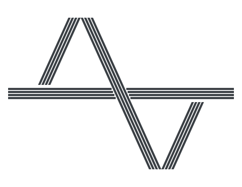

<p align="center">
  <a href="assets/app-icon.svg"></a>
</p>

NTOPIA
======

**A desktop team hub: Team Orbit announcements, events, news and discussions, plus offline tools for todos, notes and branded email.**

[Features](#features) · [Install](#install) · [Quick start](#quick-start) · [Documentation](#documentation) · [Releasing](#releasing)

---

[](.github/workflows/release.yml)
[](https://github.com/cyborgoat/ntopia/releases/latest)
[](LICENSE)
[](https://tauri.app)
[](https://tanstack.com)

## What is NTOPIA?

NTOPIA is a cross-platform desktop app with two halves:

- **Team features** that talk to a [team-orbit](https://github.com/cyborgoat/team-orbit) server: announcements, events, news, blog posts, discussions and live notifications. Signing in is optional.
- **Local tools** that work offline with no account: a todo list, a Markdown notebook, and an email composer.

NTOPIA is only a client. Auth and team data come from team-orbit through [`@goatcheese/teamorbit-client`](https://www.npmjs.com/package/@goatcheese/teamorbit-client). Nothing from team-orbit is vendored or imported by path.

## Features

- **Team Orbit.** Announcements, events, news, blog and discussions, with live notifications over Socket.io. Any member can write blog posts and start discussions. Only `ADMIN` and `SUPERUSER` can publish announcements, events and news.
- **Todo.** A local checklist stored on this device, with optional reminders.
- **Notebook.** Scratch Markdown notes with folders, trash and a resizable sidebar.
- **Email composer.** Write an email in Markdown, preview it as a branded email, and export HTML, EML, PNG or Markdown. It is available to admins only.
  - Starter templates for news, events and webinars, plus your own saved templates.
  - Frontmatter editing with autocomplete, linting and quick fixes.
  - Branding (organization, tagline, footer, logo) and color themes.
  - An image library, with import, paste and drop.
  - A built-in writing guide, with a button that copies it as a prompt for an LLM or agent.
- **Desktop integration.** Menu bar / system tray icon with quick navigation and a mute switch. Closing the window hides it to the tray so reminders and live notifications keep arriving as system notifications.
- **Automatic updates.** The app checks for new versions and installs them in one click, with no installer to open.
- **English and Chinese.** Switch the UI language in Settings.

## Install

Download the installer for your platform from the [latest release](https://github.com/cyborgoat/ntopia/releases/latest):

| Platform | Package |
| --- | --- |
| macOS (Apple Silicon) | `.dmg` |
| Windows (x64) | `.exe` (NSIS) or `.msi` |

Builds are not code-signed yet, so the first launch shows a warning:

- **macOS:** right-click the app and choose **Open**.
- **Windows:** in the SmartScreen dialog, choose **More info**, then **Run anyway**.

After the first install, updates arrive inside the app (Settings → About → Check for updates, or the tray menu).

## Quick start

**Prerequisites:** Node.js 20+, [pnpm](https://pnpm.io), and a [Rust toolchain](https://rustup.rs) with the [Tauri prerequisites](https://tauri.app/start/prerequisites/) for your OS.

```bash
# 1. Backend (optional: only needed for Team Orbit features)
cd ../team-orbit/api && npm install && npx prisma migrate dev && npx prisma db seed && npm run start:dev

# 2. App
pnpm install
pnpm tauri dev
```

You can use Home, Todo, Notebook and the gadgets right away without signing in. To unlock Team Orbit features, sign in with your username or email at your Team Orbit server URL on the login screen. Enter the server origin only, such as `https://orbit.example.com`; the client adds `/api` itself.

Dev builds default to `http://localhost:3000`. Set `VITE_DEFAULT_SERVER` to preset another URL.

On macOS, development launches **NTOPIA Dev.app** through LaunchServices so it has a Dock icon and receives keyboard input, even when started from a terminal or editor. The bundle is generated beside the Cargo executable under `src-tauri/target/`. Vite hot reload and Rust rebuilds still work, and the dev app shares NTOPIA's local data.

Build installers locally with `pnpm tauri build`.

## Documentation

- [Architecture](docs/architecture.md): stack, auth model, routes and libraries
- [Gadgets](docs/gadgets.md): built-in tools and how to add one

The email composer renders in the webview with [`@goatcheese/mdmailer-core`](https://www.npmjs.com/package/@goatcheese/mdmailer-core) (Markdown to HTML and EML in-process, PNG captured with `html-to-image`). There is no Node sidecar. The starter templates and sample host photos live in `src/gadgets/email/mdmailer/`; refresh the sample assets with `pnpm sync:mdmailer [version]`.

## Repository layout

```
src/
  lib/          Orbit client, token and server storage, auth, realtime, tray and updater hooks
  routes/       File-based routes; _app/* is the app shell (guests allowed, Orbit pages use RequireAuth)
  gadgets/      registry.ts lists gadgets; add a route and a registry entry for a new one
  features/     Standalone local features with their own sidebar entry (Todo, Settings)
  i18n/         English and Chinese messages
src-tauri/      Rust shell: tray, window behavior, plugins, capabilities
docs/           Architecture and gadget authoring notes
scripts/        Dev runner and mdmailer asset sync
```

## Tech stack

| Layer | Choice |
| --- | --- |
| Desktop shell | Tauri v2 (Rust) |
| UI | React, TanStack Router and Query |
| Styling | Tailwind CSS v4, shadcn/ui |
| Team backend | team-orbit, through `@goatcheese/teamorbit-client` |
| Email rendering | `@goatcheese/mdmailer-core` |
| Editor | CodeMirror 6 |
| Updates | Tauri updater plugin, served from GitHub Releases |

## Releasing

1. Set the same new version in `package.json`, `src-tauri/tauri.conf.json` and `src-tauri/Cargo.toml`.
2. Push a tag: `git tag vX.Y.Z && git push origin vX.Y.Z`.

The [Release workflow](.github/workflows/release.yml) builds macOS and Windows installers, signs the update bundles, and publishes them with `latest.json` to the GitHub release. Installed apps pick the update up on their next check.

The workflow needs two repository secrets, created once with `pnpm tauri signer generate`:

- `TAURI_SIGNING_PRIVATE_KEY`
- `TAURI_SIGNING_PRIVATE_KEY_PASSWORD`

The matching public key is in `src-tauri/tauri.conf.json`. Keep the private key and its password backed up: without them, installed apps can no longer be updated.

## Roadmap

Not yet supported: real chat channels and DMs (discussions use team-orbit's forum until team-orbit gains chat), OS code signing and notarization, and mobile.

## Contributing

Issues and pull requests are welcome. Run `pnpm build` (typecheck and bundle) and `cargo check` in `src-tauri` before opening a pull request.

## License

MIT. See [LICENSE](LICENSE).
