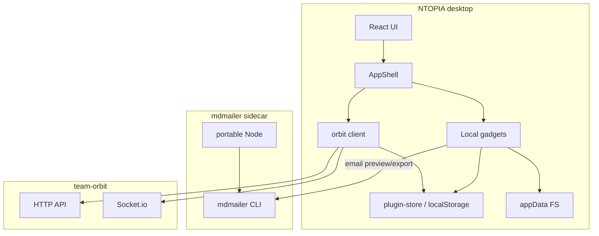

# Architecture

NTOPIA is a **Tauri v2 desktop client**. Auth and team data live in a separate **[team-orbit](https://github.com/cyborgoat/team-orbit)** backend; this repo only talks to it through `@goatcheese/team-orbit-client`. Local gadgets (email, todo) work without signing in.

## Stack

| Layer | Choice |
|--------|--------|
| Shell | Tauri v2 (`src-tauri/`) |
| UI | React 19, Vite, Tailwind v4, shadcn/ui |
| Routing / data | TanStack Router (hash history), TanStack Query |
| Backend | `@goatcheese/team-orbit-client` → team-orbit HTTP + Socket.io |
| Sidecar | Portable Node + `@goatcheese/mdmailer` for the email gadget |
| Markdown | `@mdxeditor/editor` (WYSIWYG for posts/comments), CodeMirror (email source), `react-markdown` + `remark-gfm` (rendering) |

Boot sequence (`src/main.tsx`): `initStorage` → `QueryClientProvider` → `AuthProvider` → `RouterProvider`.

## Repository layout

```
ntopia/
├── src/                 # React app
│   ├── components/      # AppShell, RequireAuth, shared UI
│   ├── gadgets/         # Local tools (registry + per-gadget modules)
│   ├── lib/             # auth, orbit, storage, realtime
│   ├── routes/          # File-based TanStack routes
│   └── main.tsx
├── src-tauri/           # Rust shell, capabilities, binaries/, resources/
├── sidecar/mdmailer/    # Build script that packs Node + mdmailer for Tauri
└── docs/                # Architecture notes (this folder)
```

## High-level flow



## Auth and access

Login is **optional**.

| State | What you get |
|--------|----------------|
| Guest (no token) | Home hub, Gadgets (email + todo), Settings (server URL + Sign in). Team Orbit nav hidden. |
| Signed in | Orbit nav + notifications + home feed. Profile/password in Settings. |

- `_app` always renders `AppShell` after auth bootstrap (`src/routes/_app.tsx`). It does **not** redirect guests to `/login`.
- Orbit-only pages wrap content in `RequireAuth` (`src/components/require-auth.tsx`) so deep links show a sign-in prompt instead of failing API calls.
- Token and server URL persist via `src/lib/storage.ts` (Tauri `plugin-store` `ntopia.json`, or `localStorage` in the browser).
- HTTP 401 (except login) clears the session through `setUnauthorizedHandler` in `src/lib/auth.tsx`.
- Live notifications: `useNotificationsSocket` connects only when a token is present (`src/lib/realtime.ts`).

Sidebar (`src/components/app-shell.tsx`):

- **Always:** Home, Gadgets, Settings
- **When signed in:** Team Orbit group (Announcements, Events, News, Blog, Discussions), Notifications, user avatar
- **When guest:** Sign in → `/login`

## Routes

List pages show summary cards that link to a detail page. Pages register breadcrumbs into the shell header with `usePageCrumbs` (`src/components/page-chrome.tsx`); `DetailPage` (`src/components/detail-page.tsx`) provides the shared detail frame.

File routes under `src/routes/`; generated tree in `src/routeTree.gen.ts`.

| Area | Paths | Notes |
|------|--------|--------|
| Public | `/login`, `/register` | Outside the shell; login can “Continue without signing in” |
| Shell | `/_app` → `AppShell` | Pathless layout; URLs stay `/`, `/gadgets`, … |
| Local | `/`, `/gadgets`, `/gadgets/email`, `/gadgets/todo`, `/settings` | No Orbit API required |
| Orbit | `/announcements`, `/events`, `/news`, `/news/new`, `/blog`, `/blog/new`, `/discussions/*`, `/notifications`; detail pages `/announcements/$id`, `/events/$id`, `/news/$id`, `/blog/$id` | Behind `RequireAuth`; `*/new` composers are full-bleed (`FULL_BLEED` in `app-shell.tsx`) |

## Key libraries (`src/lib/`)

| Module | Role |
|--------|------|
| `orbit.ts` | Creates the Team Orbit client; Tauri HTTP fetch (avoids webview CORS); `resetOrbit` after server URL changes |
| `auth.tsx` | `AuthProvider` / `useAuth` — login, register, logout, `user`, `token`, `isAdmin` |
| `storage.ts` | Sync in-memory cache over plugin-store / localStorage |
| `realtime.ts` | Socket.io notifications → toast, query invalidation, native alert when unfocused |

## Markdown editing

- `src/components/markdown-editor.tsx` — the one Markdown editor: MDXEditor (WYSIWYG, markdown shortcuts, rich-text/source toggle). `variant="full"` for posts and email, `"compact"` for comments (Mod+Enter submits). Pass `imageUploadHandler` to enable paste/drop/toolbar images and `imagePreviewHandler` to map stored `src`s to displayable URLs. It's uncontrolled internally; `value` changes from outside (resets, template loads) are pushed in with `setMarkdown`.
- `src/components/post-composer.tsx` — full-page composer (title, tags, cover, editor) behind `/news/new`, `/blog/new` and `/discussions/new`. Images upload to Orbit `/uploads`. Posts can't be edited after publishing (the API has no update endpoint).
- `.prose-ntopia` in `src/index.css` is shared by `<Markdown>` and the editor so drafts look like the published post. `.md-editor-root` maps MDXEditor's `--base*` variables to the app's theme tokens.

## Gadgets

Gadgets are small local tools. Register one in `src/gadgets/registry.ts` and add `src/routes/_app/gadgets.<id>.tsx`.

### Email composer (`/gadgets/email`)

- Implementation: `src/gadgets/email/mdmailer.ts` + route UI.
- The document is held as `meta` (frontmatter) + `body`, joined with `joinDoc` (`frontmatter.ts`) for preview/export. The body is edited as raw Markdown in `source-editor.tsx` (CodeMirror, with a formatting toolbar, ⌘B/⌘I/⌘K, and image import via button, paste or drop) — not the shared WYSIWYG `MarkdownEditor`. Frontmatter is edited in `details-bar.tsx`: a one-line summary that expands into a form whose fields come from `fields.ts` (per `type`, including hosts and agenda), plus "Edit as YAML". Keys the form doesn't know about are kept and shown under "Other fields".
- `stringifyMeta` writes YAML 1.1-safe text, because mdmailer parses with gray-matter/js-yaml (YAML 1.1), where an unquoted `15:00` would become the number 900.
- Images in the editor (pasted ones, template host photos) are relative to `work/` and shown through `mm.workAssetUrl` (blob URLs).
- Scratch workspace under app data: `email/work/`, `email/out/`, branding JSON, pasted images in `work/assets/pasted/`.
- Sidecar: `pnpm sidecar` downloads portable Node into `src-tauri/binaries/` and copies mdmailer into `src-tauri/resources/mdmailer/`. The app shells out to `node …/cli.js` for live `preview` and generate (HTML / EML / PNG).

### Todo list (`/gadgets/todo`)

- Implementation: `src/gadgets/todo/store.ts` + route UI.
- Persists `{ id, title, done, createdAt }[]` under the `todos` storage key (loaded at boot with `serverUrl` / `token`).

## Context menus

Desktop right-click menus use shadcn [`context-menu`](https://ui.shadcn.com/docs/components/base/context-menu) (`src/components/ui/context-menu.tsx`). They mirror actions already on the page (no new APIs):

| Surface | Actions |
|---------|---------|
| Todo rows / list | Toggle, delete; focus add / clear completed |
| Email editor & preview | Open in Mail, export formats, copy HTML |
| Notifications | Mark as read |
| Announcements / events / news / blog | Copy title; Delete if `isAdmin` |
| Discussion threads | Open, copy link |
| Discussion post / comments | Vote, reply |

When adding a new list surface, wrap rows with `ContextMenu` / `ContextMenuTrigger` and keep admin items behind `isAdmin`.

## Tauri surface

- Capabilities in `src-tauri/capabilities/default.json` scope FS (`$APPDATA`, resources, common user folders), shell (sidecar Node), HTTP, dialog, notifications, store.
- `externalBin`: portable Node for mdmailer.
- `resources`: bundled mdmailer package tree.

## Related docs

- [Gadgets](./gadgets.md) — how to add a gadget
- Root [README](../README.md) — run instructions and overview
